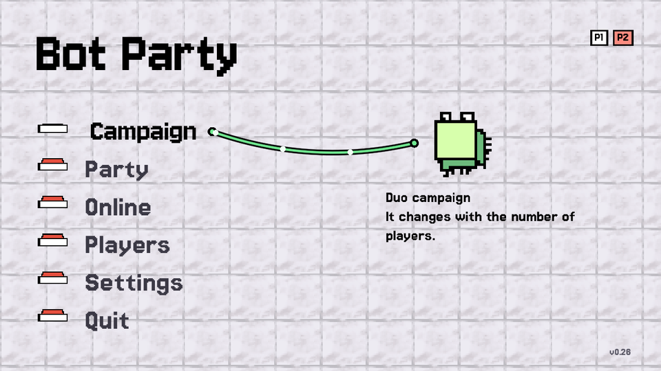
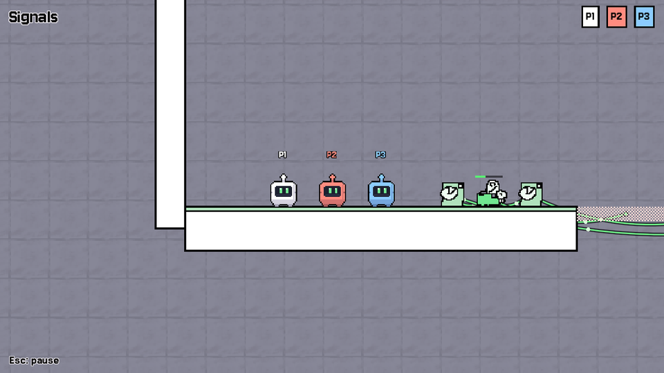
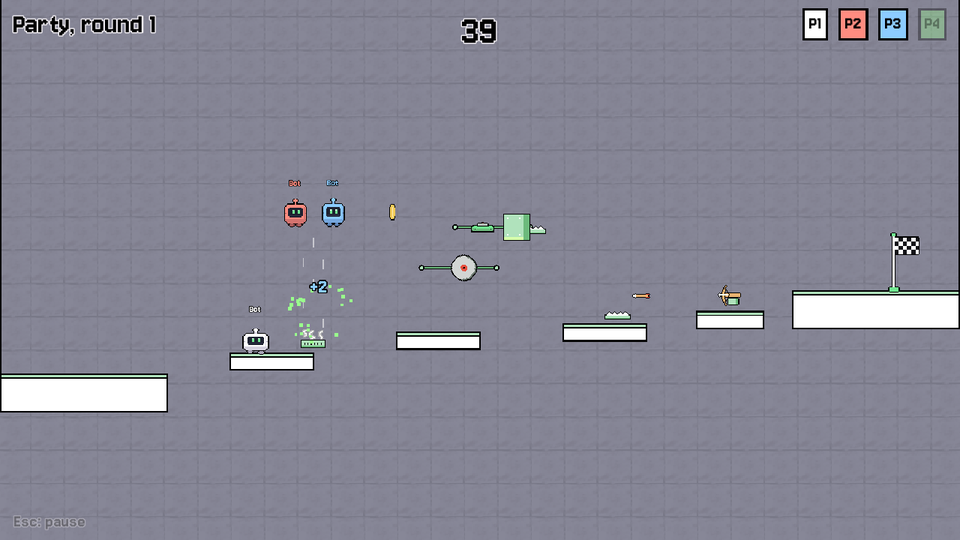
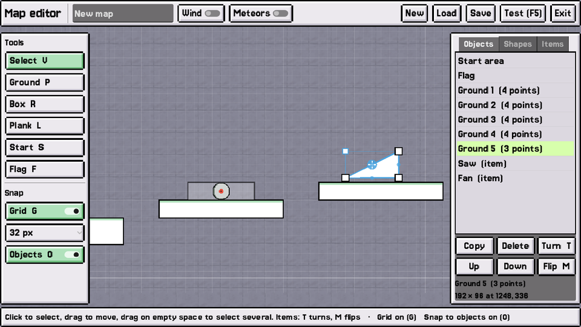

# Bot Party

A co-op puzzle platformer and party game for 1 to 8 little robots, made with
[Godot 4](https://godotengine.org). Play on one keyboard, with gamepads, online,
or against bots.



| Campaign | Party |
|---|---|
|  |  |

- **Campaign:** levels built around buttons, doors, crates and lifts that only
  work if you help each other. The set of levels changes with the number of players.
- **Party:** each round, everyone picks an item (saws, crossbows, fans, ferris
  wheels, paper planes...), places it on the course, then races to the flag.
  Reach the flag where the others can't, and score with the traps you placed.
  Rules, game modes and item odds can all be changed.
- **Online:** host a game for your friends, or find one on the server list.
  Several people can play on each computer.
- **Bots** to play against, from easy to hard.
- **Map editor** for party arenas, and **mods** for new items, maps, textures
  and game modes.

## Install

The game is built for Linux, Windows and macOS on every change. **Latest
release** is the recommended version; **nightly** is the newest build, for testing.

**Linux and macOS**, in a terminal:

```sh
curl -fsSL https://raw.githubusercontent.com/AnCarsenat/bot-party/main/install.sh | bash
```

**Windows**, in PowerShell:

```powershell
irm https://raw.githubusercontent.com/AnCarsenat/bot-party/main/install.ps1 | iex
```

Run the same command again to update. Until the first tagged release exists, add
the nightly option below. For the nightly build, or to remove the game:

```sh
curl -fsSL https://raw.githubusercontent.com/AnCarsenat/bot-party/main/install.sh | bash -s -- --nightly
curl -fsSL https://raw.githubusercontent.com/AnCarsenat/bot-party/main/install.sh | bash -s -- --uninstall
```

```powershell
& ([scriptblock]::Create((irm https://raw.githubusercontent.com/AnCarsenat/bot-party/main/install.ps1))) -Nightly
& ([scriptblock]::Create((irm https://raw.githubusercontent.com/AnCarsenat/bot-party/main/install.ps1))) -Uninstall
```

| | Installed in | Start it from |
|---|---|---|
| Linux | `~/.local/share/bot-party` | the applications menu, or `bot-party` |
| macOS | `~/Applications/Bot Party.app` | Launchpad or Finder |
| Windows | `%LOCALAPPDATA%\BotParty` | the Start menu or the desktop |

You can also download a zip from the
[Releases page](https://github.com/AnCarsenat/bot-party/releases) and run the
game from it. The macOS app isn't signed by Apple: if you open the zip yourself,
right-click the app and choose **Open** the first time.

## Playing

Join from **Players** (press your jump key), then pick **Campaign** or **Party**.

| Player | Move | Jump | Turn | Flip |
|---|---|---|---|---|
| P1 | W A S D | Space | E | R |
| P2 | Arrows | Shift | Ctrl | Enter |
| P3 | I J K L | N | U | O |
| P4 | Numpad 8 4 5 6 | Numpad 0 | Numpad Enter | Numpad + |
| P5 | T F G H | V | B | Y |
| P6 to P8 | Gamepads 1 to 3 | | | |

Keys are given by position, so on an AZERTY keyboard P1 plays with Z Q S D.
**Settings → Controls** changes any player's keys. If keys stop responding when
several people share a keyboard, the keyboard can't register that many keys at
once: give each player keys that are further apart.

Turn and Flip rotate and mirror items while you place them in party mode.

- **Bots:** in **Players**, left/right sets how many and up/down how good they are.
  They play in party mode.
- **Party rules:** **Party → Rules** sets the game mode, the winning score, the
  round time, coins, surprise rules and item odds. **Party → Items** turns items
  on and off.
- **Console:** ² or F1 (`help` lists the commands). It has cheats, `keys` (shows
  which keys the game receives), `savestate` / `loadstate`, and `inspect` (an
  in-game node and property editor).

## Online

- **Host public game:** your game appears on the server list, and friends join
  from **Server list**. If they can't reach you directly, the connection goes
  through the server's relay.
- **Host private game:** friends use **Join by address** with your IP. They need
  to reach UDP port 7777 on your computer: forward it on your router, or be on
  the same network. **Online → Port** changes the port.

The default server list is set in `project.godot` (`[bot_party]
online/server_list`). The server is a small Python script in `server/`, and
[server/DEPLOY.md](server/DEPLOY.md) explains how to run it on a VPS.

### Command line

Options go after `--`. For example, to host a party with nobody playing on the
host, starting when two players are in:

```sh
bot-party -- --host --public --port=7777 --players=0 --wait=2 --party
bot-party -- --join=203.0.113.5:7777
bot-party -- --help
```

## Making maps and mods

- **Map editor:** **Party → Map editor**. Draw ground as polygons, add planks,
  the start area, the flag and party items, with grid and object snapping. Test
  the map straight from the editor. Saved maps appear in **Party → Arena**.
- **In Godot:** open `editor/arena_template.tscn` and edit it with Godot's own
  tools. Press **Save map**, or press F6 to play it.
- **Mods** add items, maps, textures and game modes. Make them in Godot with
  `editor/mod_kit.tscn`: your scenes and scripts become a mod pack (`.pck`) that
  players drop in their mods folder and switch on in **Settings → Mods**. Map
  scenes in a pack can hold any Godot nodes. See [MODDING.md](MODDING.md) and the
  example in `mods/example` (its pack is on the Releases page).



## Working on the game

1. Install [Godot 4.7](https://godotengine.org/download).
2. Clone the repository and open `project.godot`.
3. Press F5.

| Folder | What's in it |
|---|---|
| `core/` | game state, camera, transitions, keys, save states, command line |
| `player/` | the robot |
| `objects/`, `logic/` | campaign machines: buttons, doors, lifts, logic gates |
| `levels/` | campaign levels |
| `party/` | party mode: rounds, items, arenas, bots, map format, game modes |
| `editor/` | map editor, the Godot map template, the mod kit |
| `net/` | online play (host-authoritative, with a relay) |
| `mods/` | mod loader, and mods being made (the example) |
| `ui/` | menus, console, inspector, fonts |
| `server/` | server list and relay (Python), VPS deploy scripts |

Every push to `main` builds the game and updates the nightly release. Pushing a
`v*` tag makes a release. See [BUILDING.md](BUILDING.md).

## Credits

- Game by AnCarsenat.
- Made with [Godot Engine](https://godotengine.org) (MIT license).
- Fonts: [Jersey 10 and Jersey 15](https://github.com/scfried/soft-type-jersey)
  by The Soft Type Project Authors, under the SIL Open Font License. See
  `ui/fonts/`.
